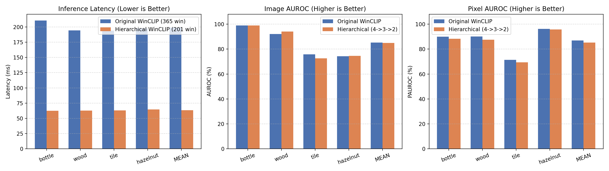
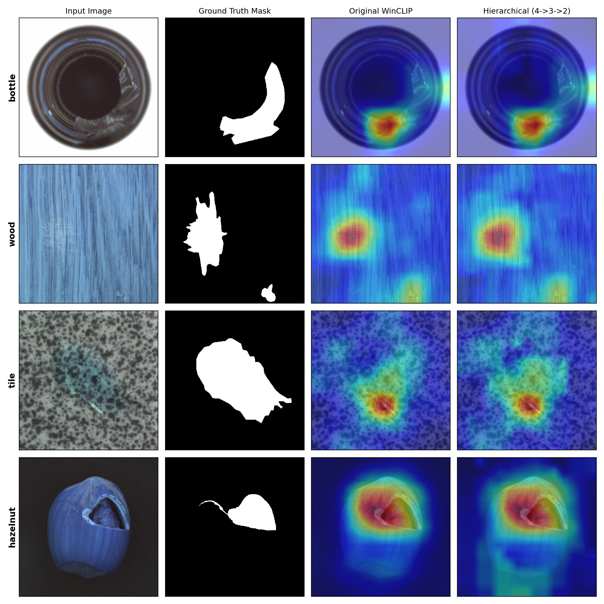

# Hierarchical WinCLIP: Coarse-to-Fine Sliding Windows for Faster Zero-Shot Anomaly Detection

This project builds on the WinCLIP paper (*WinCLIP: Zero-/Few-Shot Anomaly Classification and Segmentation*, CVPR 2023) and the PyTorch implementation from [caoyunkang/WinClip](https://github.com/caoyunkang/WinClip) to address WinCLIP's main practical bottleneck: **high inference latency from exhaustive multi-scale sliding windows**.

## The Limitation
Standard WinCLIP runs stride-1 sliding windows at 2x2 and 3x3 patch scales across the entire 15x15 ViT patch grid (**365 windows per image**). Scanning every background and normal region makes inference slow (~199 ms/image on a T4 GPU, ~5 FPS).

## Our Improvement: Hierarchical Coarse-to-Fine Sliding Windows
Implemented in `WinCLIP/hierarchical.py`, our method preserves WinCLIP's exact CLIP backbone (`ViT-B-16-plus-240`), Compositional Prompt Ensemble, and harmonic score aggregation while replacing exhaustive scanning with a 3-stage hierarchy (4x4 -> 3x3 -> 2x2):

1. **Stage 1 (4x4, stride 2):** Runs a fast coarse scan across the image to locate suspicious regions.
2. **Stage 2 (3x3, top 50%):** Evaluates only the top 50% highest-scoring candidate windows from Stage 1.
3. **Stage 3 (2x2, top 35%):** Zooms in only on the top 35% hottest regions to sharpen defect boundaries.

This reduces the number of evaluated windows from **365 to 201 (-45%)** and batches each stage cleanly on the GPU.

## Benchmark Results (MVTec-AD, Zero-Shot, T4 GPU)

| Class | Orig Latency (ms) | Hier Latency (ms) | Speedup | Orig Image AUROC | Hier Image AUROC | Orig Pixel AUROC | Hier Pixel AUROC |
| :--- | :---: | :---: | :---: | :---: | :---: | :---: | :---: |
| **bottle** | 210.50 | 62.56 | 3.36x | 98.97% | 98.89% | 90.00% | 88.21% |
| **wood** | 194.52 | 62.89 | 3.09x | 92.11% | 94.04% | 90.10% | 87.52% |
| **tile** | 194.17 | 63.08 | 3.08x | 75.79% | 72.51% | 71.37% | 69.33% |
| **hazelnut** | 197.70 | 64.55 | 3.06x | 74.25% | 74.50% | 96.18% | 95.80% |
| **MEAN** | **199.22** | **63.27** | **3.15x** | **85.28%** | **84.99%** | **86.91%** | **85.22%** |

* **Speed:** **3.15x faster** on average (**5.0 FPS -> 15.8 FPS**).
* **Accuracy Trade-off:** Only **-0.29%** Image AUROC and **-1.70%** Pixel AUROC drop across the 4 benchmark classes.

### Speed & Accuracy Comparison

### Qualitative Defect Localization

## How to Run

**1. Install dependencies:**

    pip install open_clip_torch timm loguru scikit-image scikit-learn tqdm

**2. Set dataset path:** Update `MVTEC2D_DIR` in `datasets/mvtec.py` to your local MVTec-AD directory.

**3. Run Original WinCLIP (Baseline):**

    python eval_WinCLIP.py --dataset mvtec --class-name bottle --k-shot 0 --batch-size 1 --vis False --hierarchical False

**4. Run Hierarchical WinCLIP (4x4 -> 3x3 -> 2x2):**

    python eval_WinCLIP.py --dataset mvtec --class-name bottle --k-shot 0 --batch-size 1 --vis False --hierarchical True --h-scales 4 3 2 --keep-ratios 1.0 0.5 0.35 --first-stride 2

## Key Modified / Added Files
* `WinCLIP/hierarchical.py`: Coarse-to-fine hierarchical window selection and batched per-stage inference.
* `eval_WinCLIP.py`: Added `--hierarchical`, `--h-scales`, `--keep-ratios`, `--first-stride` CLI arguments and CUDA-synchronized latency benchmarking.
* `results/`: Quantitative benchmark chart and qualitative side-by-side heatmaps.

## Acknowledgements
* Paper: Jeong et al., *WinCLIP: Zero-/Few-Shot Anomaly Classification and Segmentation* (CVPR 2023).
* Base codebase: [caoyunkang/WinClip](https://github.com/caoyunkang/WinClip).
